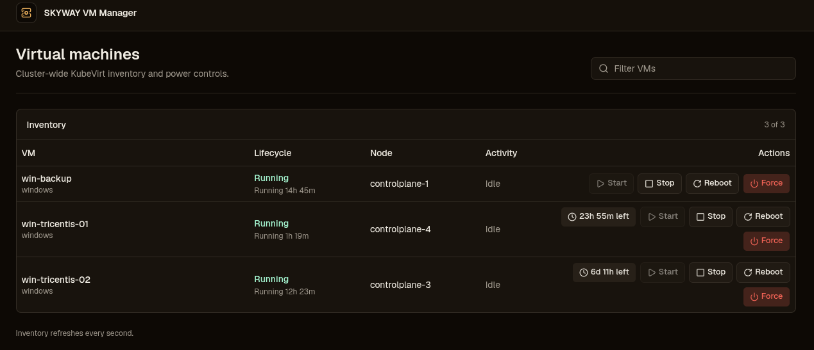
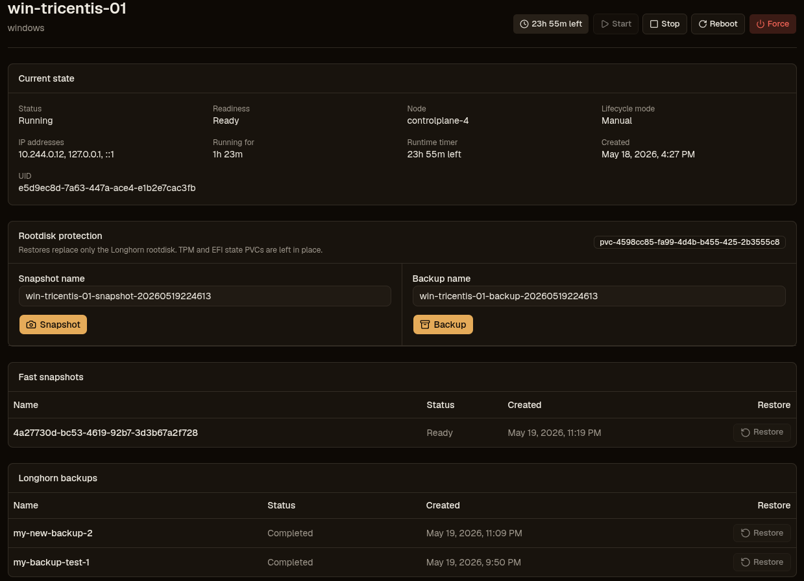

# SKYWAY VM Manager


## At a glance

A dark KubeVirt control panel for starting, stopping, snapshotting, and restoring managed SKYWAY virtual machines.



Dark-only KubeVirt control GUI for SKYWAY virtual machines.

The app has no built-in authentication and contains no secrets. Production access is expected to be enforced in front of the service by company Pangolin SSO.

## Features

- Lists explicitly managed KubeVirt `VirtualMachine` resources across all namespaces.
- Shows power state, `printableStatus`, readiness, node, IP addresses, run strategy, and active storage operations.
- Supports start, graceful stop, reboot, and force stop through the KubeVirt subresource API.
- Offers a **How to use** guide on VM detail pages (except the S/4HANA VM) with Remote Desktop steps for Windows and macOS.
- Enforces Manual VM runtime timers with resettable 1-7 day and 30-day durations.
- Supports custom-named Longhorn rootdisk snapshots and backups.
- Shows fast Longhorn snapshots and Longhorn backups separately, including recurring backups.
- Restores only the VM `rootdisk` Longhorn volume. KubeVirt `persistent-state-for-*` TPM/EFI PVCs are preserved as-is.
- Keeps the previous rootdisk PV/Longhorn volume as rollback storage for 24 hours after backup restore, with an admin discard action.
- Only manages VMs labelled or annotated with `vm-manager.skyway.tools/managed=true`; unlabeled VMs are off limits.

## Managed VM scope

VM management is explicit opt-in. The accepted enabled values are `true`, `1`, `yes`, and `on`
(case-insensitive). Before upgrading from version 0.10.2 or earlier, mark every VM that the app
should continue managing:

```sh
kubectl label virtualmachine -n <namespace> <name> vm-manager.skyway.tools/managed=true
```

Unlabeled VMs are excluded from the inventory, API actions, storage operations, and the Manual VM
runtime reconciler. Existing runtime timers on an unlabeled VM will therefore not be enforced.
Invalid marker values also fail closed and are reported in the server log.

Before setting a VM to `managed=false`, discard any retained rollback storage through the app. If a
VM was already opted out, temporarily set it back to `managed=true`, discard its rollbacks, then set
it to `managed=false` again. Rollback storage for an existing unmanaged VM is intentionally left
untouched; rollback storage for a deleted VM is reclaimed after its normal retention period.

## Screenshots




## Kubernetes Access

The server uses Kubernetes API credentials in this order:

1. In-cluster ServiceAccount credentials when `KUBERNETES_SERVICE_HOST` is present.
2. Local kubeconfig via `KUBECONFIG` or the default kubeconfig search path for development.

The app never shells out to `kubectl` or `virtctl`.

## Longhorn Access

Set `LONGHORN_API_URL` when the Longhorn backend is not reachable at the in-cluster default:

```text
http://longhorn-backend.longhorn-system.svc:9500/v1
```

## Development

```bash
pnpm install
portless vm-manager pnpm dev
```

Open `http://vm-manager.localhost:1355` when Portless falls back to its non-privileged proxy port.

## Checks

```bash
pnpm lint
pnpm typecheck
pnpm test
pnpm build
gitleaks detect
```

## Image

Release workflow publishes:

```text
ghcr.io/skyway-gmbh/vm-manager
```

Publishing waits up to 30 minutes for successful main push CI on the exact commit.
If main CI fails, re-run it and then re-run the release workflow.
Manual builds are only allowed from `main` (published as `sha-<short-commit>`) or a release tag.
Images expose their tag and commit at `/api/version` without caching. Local builds return `null`
for unset metadata.

Stable `X.Y.Z` and `vX.Y.Z` tags, pushed or manually dispatched, also run an in-cluster Flux
rollout check on `arc-skyway`.
It retries Service DNS/TCP for up to 150 seconds, then waits up to 60 minutes for matching
version/commit and a successful homepage response. A newer deployed stable version ends the
check with a warning.

The release scripts use Node 24's built-in TypeScript support and `.mts` files so they run
without dependencies or changes to the app's module configuration.
